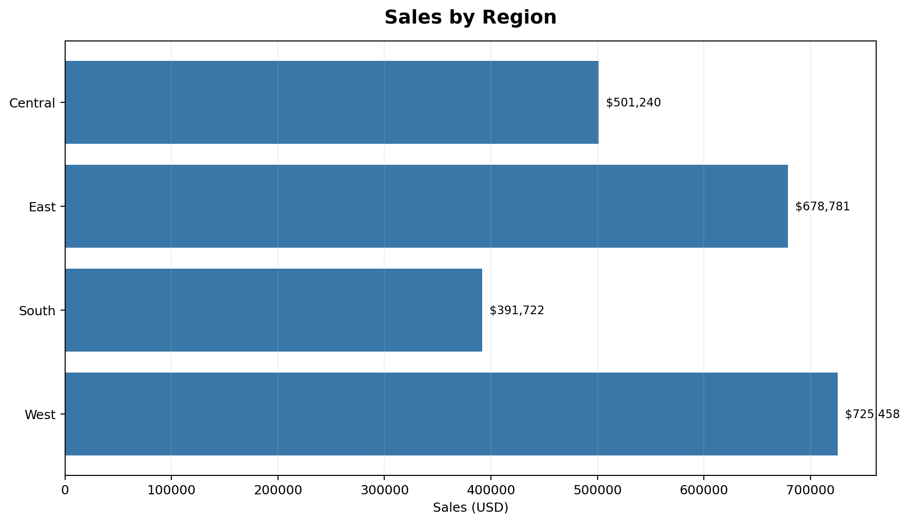
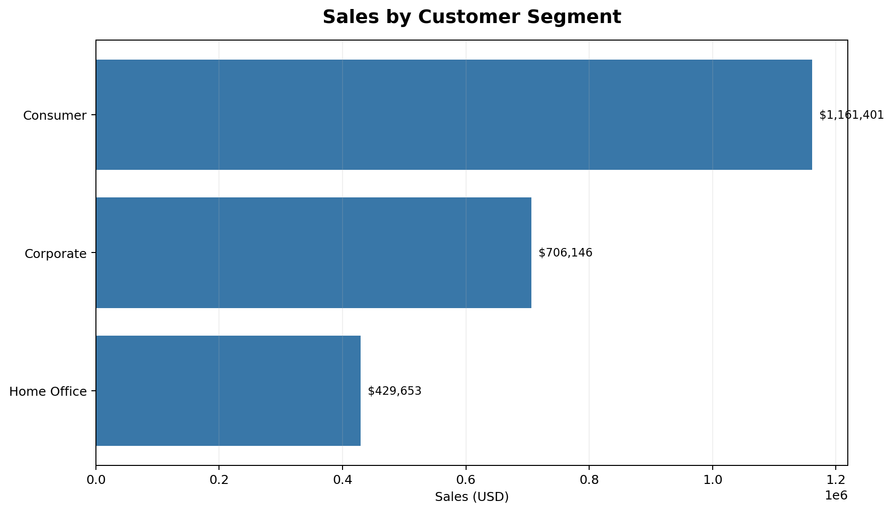
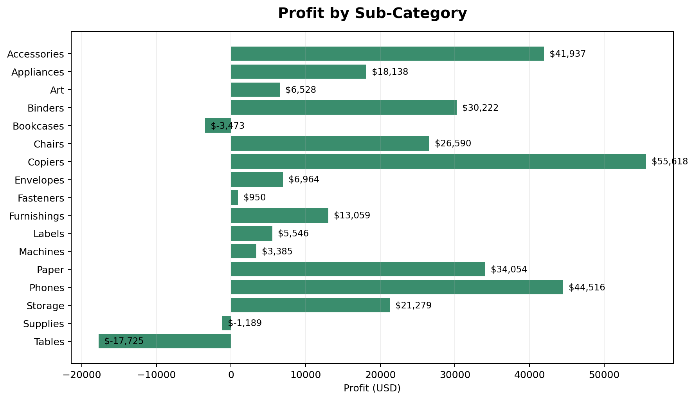
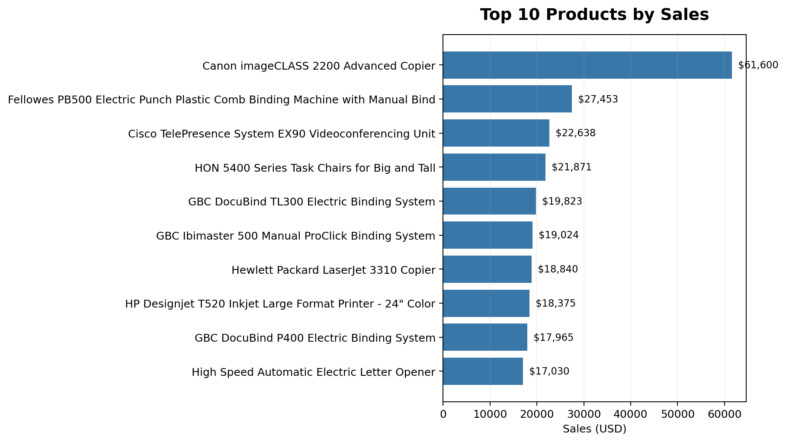

# Superstore Excel Data Analysis

An end-to-end **Microsoft Excel sales analysis project** using the Sample Superstore dataset. The project covers data cleaning and preparation, data-quality validation, exploratory analysis, and visual reporting.

## Project overview

The original dataset contains **9,994 records and 21 columns**. I used Power Query to prepare the data before analyzing it in Excel. The workbook includes the source data, a cleaned analysis table, PivotTable-based analysis, and charts.

## Data cleaning and preparation

Using **Power Query**, I prepared the dataset for analysis by:

- Reviewing the source data and its structure.
- Correcting column data types.
- Applying **Trim** and **Clean** to text fields to remove unwanted spaces and non-printable characters.
- Checking for blank values and duplicate/unique ID issues.
- Validating row counts and unique order IDs.
- Checking date consistency between Order Date and Ship Date.
- Loading the prepared data into Excel for analysis.

## Analysis included

Using PivotTables and PivotCharts, I explored:

- Sales and profit by region
- Sales by customer segment
- Sales by shipping mode
- Monthly sales trends
- Sales by category
- Sales by state, including top-performing states
- Top 10 products by sales
- Profit by product sub-category

## Key figures

| Metric | Result |
|---|---:|
| Records | 9,994 |
| Columns | 21 |
| Unique orders | 5,009 |
| Units sold | 37,873 |
| Total sales | $2,297,200.86 |
| Total profit | $286,397.02 |

## Tools and skills

- **Microsoft Excel** — data analysis and reporting
- **Power Query** — data cleaning, text transformation, data-type correction, and preparation
- **PivotTables** — summarizing, grouping, and comparing sales data
- **PivotCharts** — visualizing trends and performance
- **Data validation** — checking row counts, unique IDs, blank values, and date consistency

## Visual previews

### Sales by region

### Sales by customer segment

### Profit by sub-category

### Top 10 products by sales

## Repository files

- [Excel workbook](Superstore_Data_Analysis.xlsx) — main project file
- [Analysis summary](Analysis_Summary.csv) — key metrics
- [Data quality checks](Data_Quality_Checks.csv) — validation results
- [Screenshots](Screenshots/) — chart previews

## Data quality note

The validation found **1,708 records where Ship Date is earlier than Order Date**. These values were not changed because the correct dates could not be confirmed from the available source. Treat date-based findings with this limitation in mind.

## Author

**Sandeep Singh**

This project was completed as part of my practical learning in Excel and data analysis.
